<picture>
  <source media="(prefers-color-scheme: dark)" srcset="assets/banner-dark.svg">
  
</picture>

CS + Applied Math at the University of Rochester, working on ML systems and AI infrastructure.

#### Recent writing

<!-- BLOG-POST-LIST:START -->
<!-- BLOG-POST-LIST:END -->

<picture>
  <source media="(prefers-color-scheme: dark)" srcset="https://raw.githubusercontent.com/AkikoAkaki/AkikoAkaki/output/snake-dark.svg">
  
</picture>
